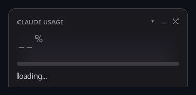
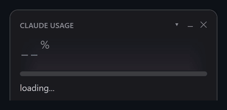
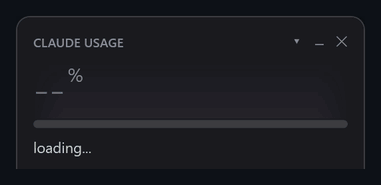

# Plasma Clawd Usage

A KDE Plasma 6 widget that shows how much of your Claude plan limits you've used:
the same numbers as `/usage` in Claude Code, refreshed every minute. Clawd, the
pixel crab, lives in it and reacts to what your sessions are doing.


This is a port of [clawd-usage-winwidget](https://github.com/Enhed/clawd-usage-winwidget)
by Venger Sergey. The layout, colors, pixel art, animations, sky and data
sources are taken from that code one to one; only the platform layer is new
(QML + JavaScript instead of PowerShell + WPF).

- **Official numbers only.** Percentages come from `claude -p "/usage"`. The
  slash command runs headless with your existing login and **does not call the
  model or spend tokens**.
- **No dependencies.** Plain QML that ships with Plasma 6. You only need Claude
  Code itself.
- **Clawd.** He sleeps in the sand when nothing runs, runs around while a
  session works, waves when a session is waiting for you, sweats near the limit
  and lies belly-up when it's used up.

## Install

Requirements: KDE Plasma 6 and [Claude Code](https://docs.claude.com/en/docs/claude-code)
installed and logged in (`claude` in `~/.local/bin` or on `PATH`).

```bash
git clone https://github.com/david-x3d/plasma-clawd-usage.git
cd plasma-clawd-usage
kpackagetool6 -t Plasma/Applet -i package
```

Then right-click the desktop or a panel → **Add Widgets…** → **Clawd Usage**.

- **On the desktop** it shows the full window.
- **In a panel** it shows the colored percentage icon (the "tray icon"); click
  it to open the window.

Update after a `git pull`:

```bash
kpackagetool6 -t Plasma/Applet -u package
```

## What it shows

- **Big number** – current session (the 5-hour window). The bar goes
  green → yellow (60%) → red (85%).
- **resets in 3h 03m** – time until the window resets.
- **WEEK** – weekly limit and time to reset. **FABLE · WEEK** – the separate
  weekly Fable limit; hidden if `/usage` doesn't report it.
- **SESSIONS** – how many Claude Code sessions run, how many are working and
  how many wait for you. Hover for the list.
- **Service status** – from status.claude.com; click to open it.
- **Panel icon** – the same percentage as a colored number; the tooltip adds
  week and Fable.
- **Bottom line** – plan, account email and time of the last `/usage` answer.

The ▾ in the header expands details: last 24 hours / 7 days stats from
`/usage`, and your Claude Code version. When an update is out the line turns
yellow; hover for the changelog, click to run `claude update` in Konsole.

Right-click the widget for refresh, larger/smaller and language (English,
Русский). All other settings are in **Configure Clawd Usage…**.

### Clawd

<table>
<tr>
<td align="center"><br><sub>No Claude Code running: burrows into the sand and sleeps</sub></td>
<td align="center"><br><sub>Click him: a random Claude Code animation and a heart</sub></td>
</tr>
<tr>
<td align="center"><br><sub>Session limit used up: belly-up; click and his soul floats out</sub></td>
<td align="center"><br><sub>The 5-hour window resets: celebration and confetti</sub></td>
</tr>
<tr>
<td align="center"><br><sub>Hearts are his health: the session limit left</sub></td>
<td align="center"><br><sub>The sky follows real time of day and live weather</sub></td>
</tr>
</table>

Right-click Clawd for developer mode: force any state, play any animation, set
the hearts, pick time of day and weather, or play everything as a demo.

### Sky

Behind the numbers is a faint sky that follows real sunrise and sunset, the
moon in its actual phase, and live weather: clouds, rain, snow, fog and
thunderstorms. Weather comes from [Open-Meteo](https://open-meteo.com), falling
back to [met.no](https://api.met.no); location is looked up once by IP via
[ipwho.is](https://ipwho.is). Set coordinates in the settings to skip that, or
turn the sky off.

## Where the data comes from

| what | source | how often |
|---|---|---|
| limits and stats | `claude -p "/usage" --output-format text` | every 60 s |
| sessions | `~/.claude/sessions/<pid>.json`, live processes only | every tick |
| account | `claude auth status` | every 10 min |
| latest version | `downloads.claude.ai/claude-code-releases/latest` | hourly |
| changelog | `anthropics/claude-code` CHANGELOG.md | only when an update is available |
| status | `status.claude.com/api/v2/summary.json` | every 2 min |
| weather | Open-Meteo / met.no, location via ipwho.is | every 15 min |

## How it's built

`package/` is the Plasma applet. `contents/ui/main.qml` polls the data,
`Card.qml` is the window from the original `widget.xaml`, `DevMenu.qml` the
developer menu. `contents/code/` holds the JavaScript ports of the original
modules: `mascot.js`, `sky.js`, `parse.js` and `strings.js` (all UI text).

## License

[MIT](LICENSE)

---

Not affiliated with Anthropic. Clawd and Claude are Anthropic's.
